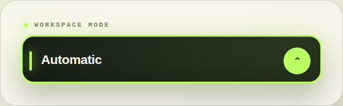
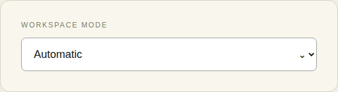
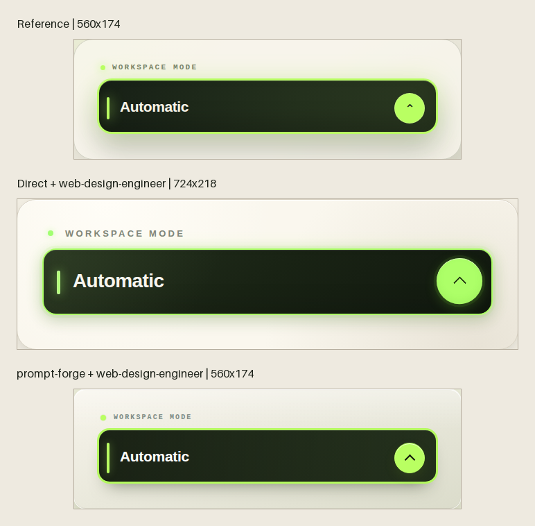
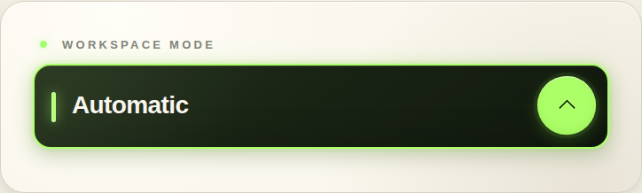
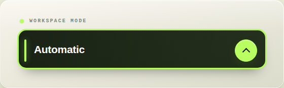

# Prompt Forge 前端视觉任务 A/B 测试

日期：2026-10-25  
任务类型：参考图驱动的原生 `<select>` hover 还原  
结论级别：单任务 smoke test，不是普遍性能结论

## 测试问题

同一句含糊需求：

> 给你一张图片，把前端选择框 hover 做成图片那种效果，尽量做到最佳效果。

比较两种完整工作流：

1. **direct**：直接执行原始需求，明确禁止调用提示词优化 skill。
2. **prompt-forge**：加载 `prompt-forge`，按 skill 的路由、证据和验收流程执行。

两臂使用同一模型、图片、初始 HTML、仓库指令、权限、超时和检查。运行顺序由固定 seed 随机化。

需要注意：direct 仍自动使用了 `web-design-engineer`，因此这里比较的是
**“视觉设计 skill”与“视觉设计 skill + prompt-forge”**，不是“有 skill 与完全无 skill”。

## 测试数据

参考图由独立 HTML/CSS 页面渲染，不包含第三方品牌资产。核心特征：

- 暖象牙色外层面板；
- 近黑橄榄绿的 native select；
- 荧光青柠色描边、左侧短色条和圆形箭头按钮；
- 轻微扩散光晕与内高光；
- hover 时边框增强、控件上浮、箭头圆面点亮。

初始 fixture 只有一个保留默认样式的原生 `<select>`：

## 结果总览

| 指标 | direct | prompt-forge | 差异 |
|---|---:|---:|---:|
| 基础检查 | 5/5 | 5/5 | 持平 |
| 首次通过 | 是 | 是 | 持平 |
| 完成时间 | 87.72 s | 271.84 s | prompt-forge 约 3.10× |
| 输入 token | 893,849 | 3,906,148 | 约 4.37× |
| 输出 token | 14,788 | 39,569 | 约 2.68× |
| 命令失败代理 | 1 | 6 | 高 5 次 |
| 范围事故 | 0 | 0 | 持平 |
| 改动文件 | 1 | 1 | 持平 |

prompt-forge 的命令失败主要是浏览器启动环境、Firefox Snap 受限，以及一次错误像素坐标探测；它们触发了自修复和视觉迭代，不全是实现错误。

## 视觉结果

三张图保持原始截图尺寸，没有为了比较而缩放：

提示词变体：

### 几何尺寸

| Arm | 截图尺寸 |
|---|---|
| Reference | 560 × 174 |
| direct | 724 × 218 |
| prompt-forge | 560 × 174 |

direct 把面板横向和纵向放大；prompt-forge 保持了参考图的完整组件尺寸。

### 像素指标

比较时统一缩放到 256 × 96。指标越低越好，SSIM 越高越好。

| 指标 | direct | prompt-forge | 结果 |
|---|---:|---:|---|
| Normalized MAE | 0.073475 | 0.022680 | prompt-forge 约低 69.1% |
| Histogram distance | 0.166807 | 0.126949 | prompt-forge 约低 23.9% |
| SSIM | 0.782650 | 0.879945 | prompt-forge 更高 |

这些指标只能衡量像素和全局色彩接近程度，不能单独证明设计质量。人工检查同样显示
prompt-forge 的组件边界、面板尺寸、圆角比例和按钮位置更接近参考图。

## 行为验证

两臂都满足：

- 保留 `select#tier`；
- 保留 Automatic、Focus、Deep work 三个选项；
- hover 前后视觉属性发生变化；
- 375px viewport 内没有横向越界；
- `prefers-reduced-motion: reduce` 下过渡接近 0。

差异：

- direct 的键盘焦点没有可见 `outline`，依赖 `box-shadow`，检测结果为
  `outline: none`；
- prompt-forge 的键盘焦点有 `outline: solid`，视觉提示更明确。

## 为什么产生差异

prompt-forge 组没有直接套用常见“荧光绿 hover”模板，而是：

1. 先读取参考图并拆分颜色、描边、圆角、阴影、左侧强调条和按钮几何；
2. 保留原生 `<select>`，避免为了控制弹层而擅自替换组件；
3. 通过浏览器截图和 PIL 像素采样反复调整；
4. 最后验证键盘焦点、窄屏和 reduced-motion。

direct 组也读到了 `web-design-engineer`，因此基础审美并不差；它主要输在尺寸和
像素级参考校准，而不是完全不会做视觉。

## 结论

在这个参考图驱动任务中，使用 prompt-forge 带来了可测的视觉收益：

- 截图尺寸与参考完全一致；
- MAE 和直方图距离明显更低；
- SSIM 更高；
- 焦点状态更明确。

代价同样明显：

- 时间约 3.1 倍；
- 输入 token 约 4.4 倍；
- 工具调用和自修复次数更多。

因此合理结论是：**prompt-forge 适合“视觉还原要求高、可以接受多轮测量和较高成本”的任务；普通 hover 或一般界面微调没有必要强制使用。**

单次任务只能算 smoke test。要验证稳定性，至少还应加入不同视觉风格、React 组件库、
自定义 listbox 和移动端触摸场景。
